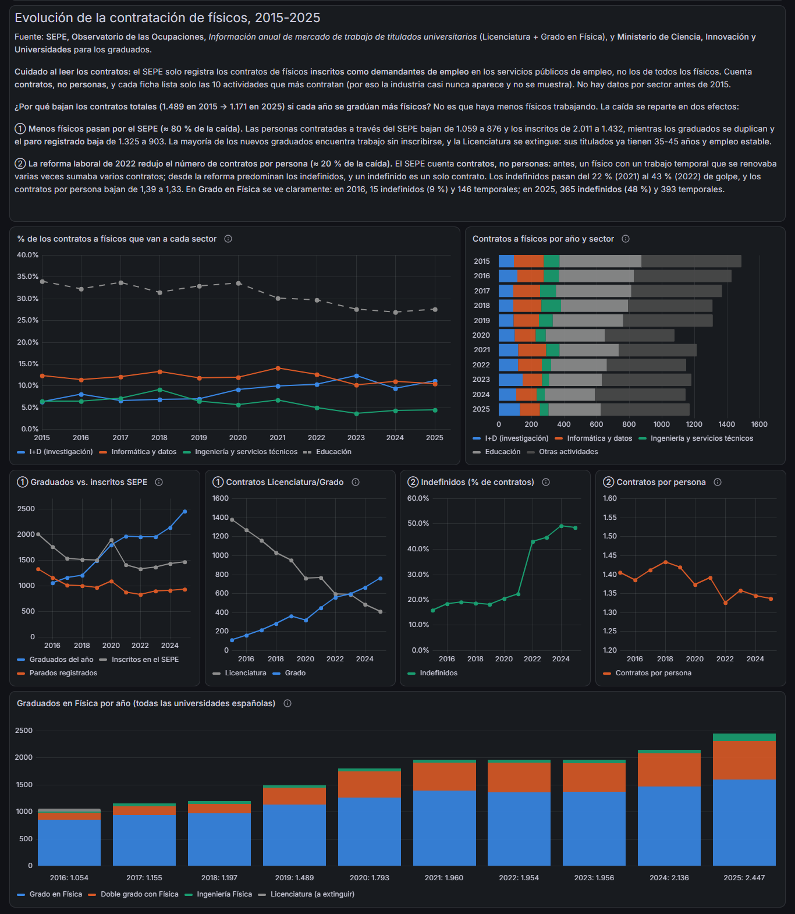
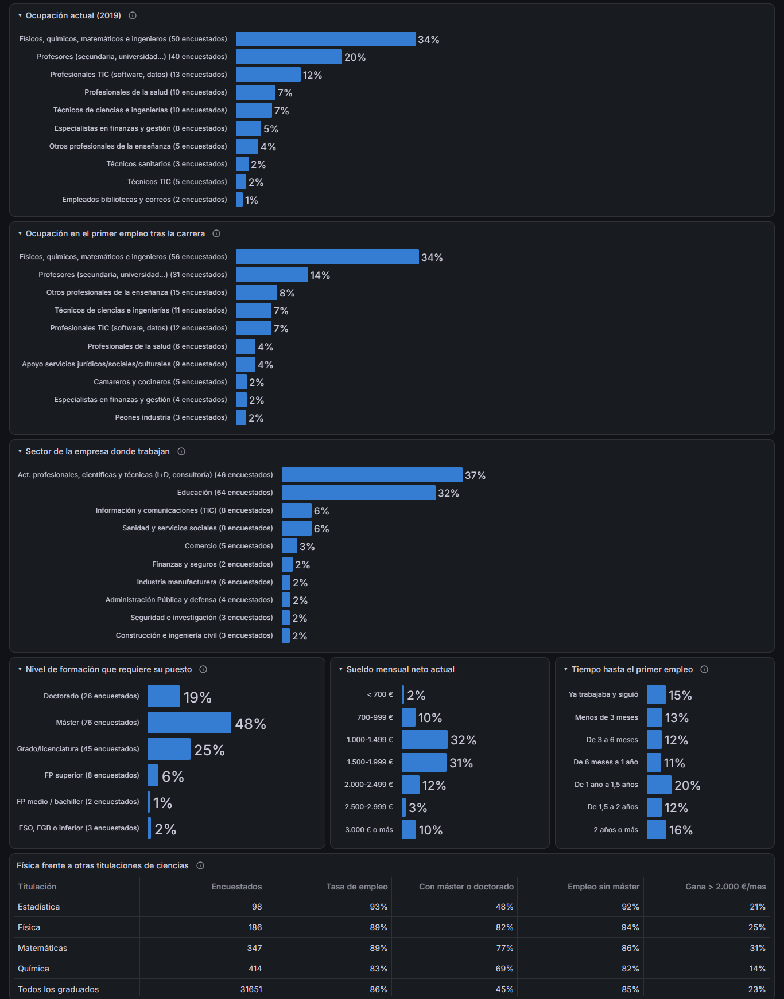

# Inserción laboral de los graduados en Física en España

¿Qué trabajo encuentra un físico recién graduado? ¿En qué sectores? ¿Hace falta un máster? ¿Cómo ha evolucionado la
contratación de físicos en la última década?

Este proyecto responde a esas preguntas con **datos oficiales** (INE, SEPE y Ministerio de Universidades). Los extrae y
limpia con **Python**, los modela en **MySQL** y los presenta en un dashboard de **Grafana**.


## Conclusiones principales

**Inserción laboral, 5 años después de titularse (INE, EILU 2019, promoción 2013-14):**

- El **89 %** de los físicos trabaja y la tasa de paro es del **5,6 %**, mejor que la media de graduados (86 % de empleo).
- **Sin máster también se encuentra trabajo:** el 18 % no tiene máster ni doctorado, y de ellos trabaja el 94 %
  (muestra pequeña: 36 encuestados). Aun así, lo habitual es seguir estudiando: el 62 % tiene máster y el 19 % es doctor.
- **Ocupaciones:** físicos, químicos, matemáticos e ingenieros (34 %), profesores (20 %), profesionales TIC (12 %) y
  sanidad (7 %, radiofísica hospitalaria).
- **Sectores:** I+D y consultoría técnica (37 %), educación (32 %), TIC (6 %) y sanidad (6 %).
- **Trabajo en el extranjero:** el 21 % de los físicos que trabajan lo hace fuera de España, frente al 7 % del conjunto
  de graduados. Entre los doctores en Física la cifra sube al 46 %.

**Evolución, 2015-2025 (SEPE y Ministerio de Universidades):**

- Los **graduados en Física se han más que duplicado**: de 1.054 en 2016 a 2.447 en 2025. El mayor crecimiento está en
  los dobles grados, sobre todo Física + Matemáticas.
- El **paro registrado de físicos baja** de 1.325 a 903 en ese mismo periodo.
- Entre los contratos registrados por el SEPE, la **I+D casi duplica su peso** (del 6 % al 11 %). Informática y datos
  se mantiene en torno al 10-14 % y la educación baja del 34 % al 27 %.
- Los contratos registrados por el SEPE bajan (de 1.489 a 1.171), pero **no porque haya menos físicos trabajando**:
  - **≈ 80 % de la caída** se debe a que menos físicos buscan trabajo a través del SEPE.
  - **≈ 20 %** se debe a la **reforma laboral de 2022**: los indefinidos pasan del 22 % al 43 % de los contratos y los
    contratos por persona bajan de 1,39 a 1,33.



## Fuentes de datos

| Fuente | Qué aporta | Formato original |
|---|---|---|
| [INE – Encuesta de Inserción Laboral de Titulados Universitarios (EILU) 2019](https://www.ine.es/dyngs/INEbase/operacion.htm?c=Estadistica_C&cid=1254736176991&idp=1254735976597) | Situación laboral, ocupación, sector, sueldo y formación de 31.651 graduados (186 físicos) | Microdatos CSV |
| [SEPE – Información del mercado de trabajo de titulados universitarios](https://www.sepe.es/HomeSepe/que-es-observatorio/informacion-titulaciones/informacion-titulaciones-universitarias.html) | Contratos por actividad económica, demandantes, parados y tipo de contrato de los físicos, 2015-2025 | Un PDF por año (2016 escaneado) y una web para 2025 |
| [Ministerio de Ciencia, Innovación y Universidades – Estadística de Estudiantes](https://www.ciencia.gob.es/Ministerio/Estadisticas/SIIU/Estudiantes.html) | Egresados por titulación, cursos 2015-16 a 2024-25 | Excel |

Todos los datos son información pública reutilizable con cita de la fuente.

## Limitaciones

- **EILU:** es una foto de una sola promoción (titulados en 2014, entrevistados en 2019), no una serie temporal.
  Con 186 físicos, las categorías con menos de 10 encuestados son orientativas. Todas las cifras están ponderadas con el
  factor de elevación del INE.
- **SEPE:** solo registra los contratos de físicos **inscritos como demandantes de empleo**, no los de todos los
  físicos. Cuenta **contratos, no personas**. Cada ficha lista solo las 10 actividades más contratadas, por eso la
  industria casi nunca aparece. El PDF de 2016 es un escaneo y sus cifras se transcribieron a mano (están en
  `sepe_contratos.py`).
- **Egresados:** cada persona con doble grado cuenta una vez.

## Arquitectura

```
INE (CSV)          ─┐
SEPE (PDF / web)   ─┼─► Python (pandas, PyMuPDF) ─► SQL ─► MySQL (base `eilu`) ─► Grafana (dashboard as code)
Ministerio (XLSX)  ─┘
```

| Script | Qué hace | Tablas que genera |
|---|---|---|
| `etl_eilu.py` | Descarga los microdatos de la EILU, decodifica las variables con el diseño de registro del INE y crea las vistas de análisis | `graduados`, `v_fisica_*`, `v_comparativa_titulaciones` |
| `sepe_contratos.py` | Descarga y parsea los informes anuales del SEPE (PDF) y la web de 2025 | `sepe_contratos_total`, `sepe_contratos_sector`, `v_sepe_fisica_sector_anual` |
| `egresados_fisica.py` | Clasifica las titulaciones de Física en el Excel de egresados | `egresados_fisica` |
| `build_dashboard.py` | Define el dashboard de Grafana en Python (paneles, consultas SQL, colores) | → `dashboard_fisica.json` |
| `deploy_grafana.py` | Crea la fuente de datos MySQL y sube el dashboard por la API de Grafana | — |

## Cómo reproducirlo

Requisitos: Python 3.9+, MySQL 8+ y Grafana 11+.

```bash
pip install -r requirements.txt

# 1. Generar los SQL (descargan los datos en data/)
python etl_eilu.py
python sepe_contratos.py
python egresados_fisica.py

# 2. Cargarlos en MySQL (eilu.sql crea la base `eilu`, así que va primero)
mysql -u root -p < eilu.sql
mysql -u root -p < sepe_contratos.sql
mysql -u root -p < egresados_fisica.sql

# 3. Usuario de solo lectura para Grafana (cambia la contraseña en setup_mysql.sql)
mysql -u root -p < setup_mysql.sql

# 4. Dashboard: guarda la contraseña del paso 3 en .mysql_grafana_pass y un token de
#    service account de Grafana (rol Admin) en .grafana_token. Ambos están en .gitignore.
python build_dashboard.py
python deploy_grafana.py
```

El dashboard queda en `http://localhost:3000/d/eilu-fisica`.



## Autor

Albert Rius Saborit, graduado en Física. Proyecto personal de análisis de datos.
